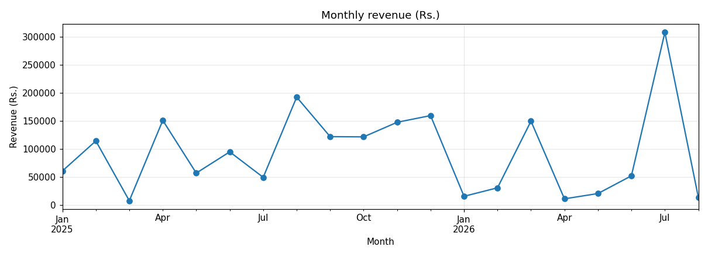
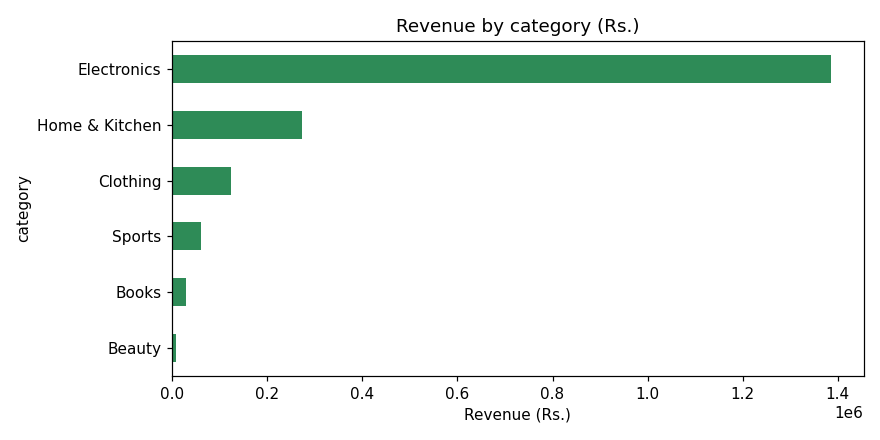
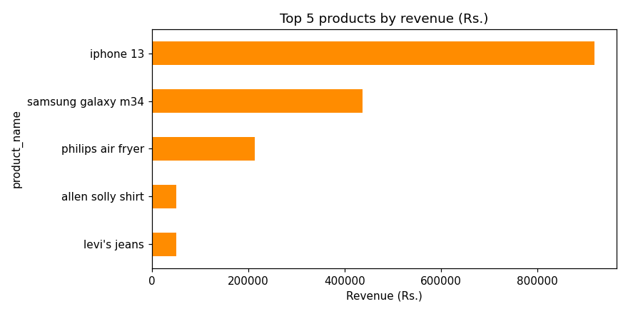
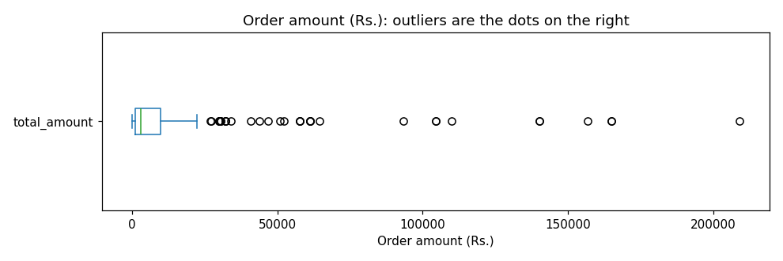

# E-commerce Sales Analysis: From Messy Data to Business Insights

An end-to-end data analytics project: clean a messy e-commerce orders dataset with **pandas**, explore it with **matplotlib**, present it in an interactive **Power BI** dashboard, and turn the findings into business insights.

> The dataset is synthetic (generated for practice), so the findings describe this sample and not a real company.

## Contents

1. [Problem statement](#1-problem-statement)
2. [Dataset information](#2-dataset-information)
3. [Cleaning process](#3-cleaning-process)
4. [Analysis (EDA)](#4-analysis-eda)
5. [Dashboard (Power BI)](#5-dashboard-power-bi)
6. [Key business insights](#6-key-business-insights)
7. [Recommendations](#7-recommendations)
8. [Project structure](#8-project-structure)
9. [How to run](#9-how-to-run)
10. [Limitations](#10-limitations)

---

## 1. Problem statement

An online store collects order data, but the raw file has quality problems (missing values, duplicate records, wrong values and inconsistent spellings), so its numbers cannot be trusted. The business also has no clear view of what drives its sales or where it loses money.

**Objectives**
1. Find and fix the data quality problems.
2. Describe sales with key statistics, trends, patterns and anomalies.
3. Build a dashboard that lets a manager explore the results.
4. Turn the findings into insights and recommendations.

## 2. Dataset information

| Item | Detail |
|---|---|
| Source | Synthetic data created with Python for practice (names, emails and phone numbers are fake) |
| Raw file | `data/ecommerce_orders_messy.csv`: 281 rows, 19 columns |
| Cleaned file | `data/ecommerce_orders_cleaned.csv`: 252 rows, 19 columns |
| Power BI file | `data/ecommerce_orders_powerbi_ready.csv`: 252 rows, 18 columns (no rating column; blank cells instead of `Unknown` in the date columns) |
| Period | January 2025 to August 2026 |
| Coverage | 15 customers, 15 products in 6 categories, 8 cities in 7 states (India), 5 payment methods |

**Data dictionary**

| Column | Meaning |
|---|---|
| `order_id` | Unique order number |
| `customer_id`, `customer_name` | Customer identifier and name |
| `email`, `phone` | Customer contact details |
| `order_date` | Date the order was placed |
| `product_name`, `category` | Product bought and its category |
| `quantity`, `unit_price` | Items bought and price per item (₹) |
| `discount_pct` | Discount given (0 to 20%) |
| `total_amount` | quantity × unit_price × (1 − discount) in ₹ |
| `payment_method` | Credit Card, Debit Card, UPI, Cash on Delivery, Net Banking |
| `order_status` | Delivered, Shipped, Pending, Cancelled, Returned |
| `city`, `state`, `country` | Delivery location |
| `delivery_date` | Date the order was delivered (empty if never delivered) |
| `rating` | Customer rating from 1 to 5 (delivered orders only) |

## 3. Cleaning process

Code: [`notebooks/01_data_cleaning.ipynb`](notebooks/01_data_cleaning.ipynb) (pandas only, every line commented).

| Problem type | Examples found | How it was handled |
|---|---|---|
| **Missing values** | Blank cells, `NULL`, `N/A`, `nan` | Placeholders turned into real missing values; category and price filled from the same product, name and email filled from the same customer; labelled `Unknown` where nothing can be guessed (payment, city, phone) |
| **Duplicate records** | Exact copies and repeated `order_id` | `drop_duplicates()`, keeping the first row (21 rows removed) |
| **Incorrect values** | Negative or huge quantities and prices, ratings outside 1 to 5, discounts of 100% or more, future dates, delivery before order, invalid emails and phones, wrong totals | Out-of-range values set to missing, then filled by rule; totals recalculated from quantity, price and discount |
| **Inconsistent values** | `Deliverd` / `Delivered`, `Bangalore` / `Banglore` / `Bengaluru`, `UPI` / `upi`, mixed date formats, `C1006X` customer IDs | Standardised with `.str` methods and `.replace()` dictionaries |

**Steps:** inspect → remove extra spaces → standardise text → fix data types and dates → fix incorrect values → remove duplicates → fill missing values → set final types and save.

**Result:** 281 raw rows became 252 clean rows. The only blanks left are by design: no delivery date for cancelled or pending orders, and no rating for orders that were not delivered or not rated.

## 4. Analysis (EDA)

Code and charts: [`notebooks/02_eda.ipynb`](notebooks/02_eda.ipynb), PNG copies in [`charts/`](charts/).

**Key statistics (252 orders)**

| Measure | Value |
|---|---|
| Total order value | ₹34.1 lakh |
| Revenue (without cancelled and returned orders) | ₹18.8 lakh |
| Average order value | ₹12,768 |
| Median order value | about ₹3,000 |
| Orders cancelled / returned / delivered | 23.0% / 18.7% / 21.0% |
| Average rating | 3.07 (from 45 ratings) |
| Average delivery time | 5.4 days |

**Methods:** summary statistics, monthly trend, weekday pattern, revenue by category, product, city and payment method, correlation table, and outlier detection with the IQR rule (an order is an outlier if it is above Q3 + 1.5 × IQR, which is ₹22,967 here).









## 5. Dashboard (Power BI)

Files in [`dashboard/`](dashboard/):

| File | Purpose |
|---|---|
| `SWYNEX_Dashboard_v2.pbix` | The Power BI dashboard (open with Power BI Desktop on Windows) |
| `dax_measures.md` | Date table and all DAX measures used by the dashboard |
| `ecommerce_powerquery.m` | Power Query script that loads `data/ecommerce_orders_powerbi_ready.csv` with the right data types |
| `ecommerce_teal_theme.json` | Colour and font theme |

**Page 1: Executive Overview**
- Five KPI cards: Revenue, Total order, Avg order value, Lost(%), Total sale
- Revenue by month (line), orders by status (donut), revenue by category (bar) and revenue by city (bar)
- Slicers: year, category, city, payment method

**Page 2: Operations & Risk**
- Four KPI cards: cancel rate, return rate, Avg order value, Outlier Orders
- Cancel rate by payment method, and orders by category, state, weekday and product
- The same four slicers

**Page 3: Key Insights**
- The key business insights and recommendations from sections 6 and 7

**Design choices:** a teal palette on a dark teal background, light cards with rounded corners, the same fonts and sizes everywhere, and cross-filtering between visuals.

<!-- After you export the dashboard, save the images in the dashboard folder and remove these comment markers:


-->

**To open it:** open `dashboard/SWYNEX_Dashboard_v2.pbix` in Power BI Desktop. If the data does not load, change the file path of the `orders` query to where you saved `data/ecommerce_orders_powerbi_ready.csv` (Home, then Transform data, then the Source step).

## 6. Key business insights

1. **Revenue depends on a few expensive products.** Electronics is 73.8% of revenue but 22% of orders. The iPhone 13 alone brings 48.9%, and the top 3 products bring 83.6%.
2. **Almost half of the order value is lost.** 23.0% of orders are cancelled and 18.7% are returned, so ₹15.3 lakh of the ₹34.1 lakh ordered (44.9%) never becomes revenue.
3. **Cancellations differ by payment method.** Credit Card is highest (31.4%) and Net Banking lowest (14.6%), but each method has only 41 to 57 orders.
4. **Revenue is lumpy and has anomalies.** The average order is ₹12,768 but the median is only about ₹3,000. 35 outlier orders (13.9% of orders) make up 72.5% of order value. July 2026 revenue was about 3.3 times a normal month, and more than half of it came from one iPhone order of ₹1,64,997.
5. **Two cities generate half of the revenue.** Hyderabad (25.3%) and Bengaluru (23.6%) together make 48.9%; Chennai is lowest at 1.9%.
6. **Order value is driven by price, not by quantity or discounts.** Order amount follows unit price closely (correlation 0.90). Discounts of 0 to 20% show almost no link to quantity (-0.05).
7. **Customers who rate are split.** 37.8% of ratings are 1 or 2 stars and 40.0% are 4 or 5, so few customers are in the middle.

## 7. Recommendations

These are ideas that follow from the data and should be tested before acting on them.

1. **Find out why orders are cancelled and returned.** This is the biggest leak (44.9% of order value). Collect a reason for every cancellation and return.
2. **Protect the top products.** Keep iPhone, Samsung and Air Fryer well stocked and priced, and look for ways to lift lower-priced categories.
3. **Look at the Credit Card checkout.** Its cancellation rate is the highest; check for payment failures or a confusing step.
4. **Check the Chennai market.** Its revenue is far below the other cities; find out whether it is a small market or a delivery or marketing gap.
5. **Test discounts before spending on them.** In this data they did not lead to bigger baskets.
6. **Report the median next to the average,** and review large orders on their own, so a few big purchases do not distort monthly results.

## 8. Project structure

```text
├── README.md
├── data/
│   ├── ecommerce_orders_messy.csv           # raw data with quality problems
│   ├── ecommerce_orders_cleaned.csv         # output of the cleaning notebook
│   └── ecommerce_orders_powerbi_ready.csv   # cleaned data prepared for Power BI
├── notebooks/
│   ├── 01_data_cleaning.ipynb               # cleaning (pandas)
│   └── 02_eda.ipynb                         # analysis, charts and insights
├── charts/                                  # PNG copies of the EDA charts
└── dashboard/
    ├── SWYNEX_Dashboard_v2.pbix             # Power BI dashboard
    ├── ecommerce_powerquery.m               # Power Query load script
    ├── dax_measures.md                      # DAX measures used by the dashboard
    └── ecommerce_teal_theme.json            # Power BI theme
```

## 9. How to run

```bash
pip install pandas matplotlib jupyter
jupyter notebook
```

1. Open `notebooks/01_data_cleaning.ipynb` and use **Run All**. It reads the raw file from `data/` and writes the cleaned file.
2. Open `notebooks/02_eda.ipynb` and use **Run All**.
3. For the dashboard, follow section 5.

## 10. Limitations

- Only 252 orders, 15 customers and 45 ratings, so small differences (payment method, weekday, rating by category) can be chance.
- Revenue excludes cancelled and returned orders and counts pending orders as expected sales.
- A few missing dates were estimated from the median delivery time during cleaning.
- The data is synthetic, so the results show the method and not real business performance.

## Tools

Python (pandas, matplotlib), Jupyter Notebook, Power BI Desktop (Power Query and DAX).

## Author

Gautam
